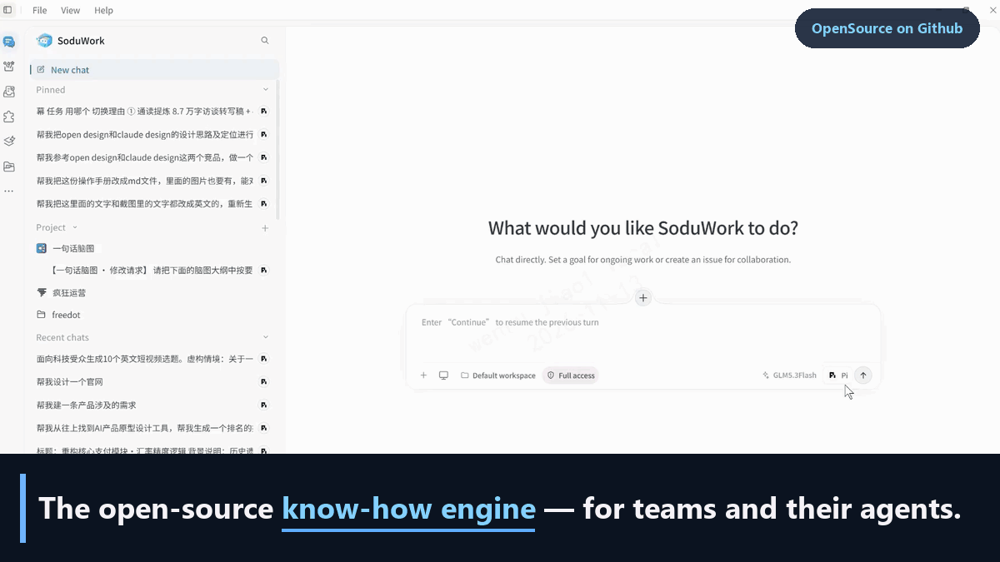
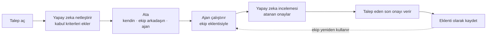

[English](README.md) · [简体中文](README.zh-CN.md) · **Türkçe**

<div align="center">


# SoduWork

## Ekipler ve ajanları için yapay zeka tabanlı çalışma motoru

**Bir sohbet bir yanıtla biter. Bir SoduWork talebi ise isteyen kişi onayladığında biter.**

<a href="https://trendshift.io/repositories/350333?utm_source=repository-badge&amp;utm_medium=badge&amp;utm_campaign=badge-repository-350333" target="_blank" rel="noopener noreferrer">
  
</a>

**Çoklu harness · Çoklu ajan · Kendi sunucunuzda barındırılabilir**



Pi · OpenCode · DeepSeek Harness · Qwen Code · Kimi Code · Codex Harness · Codex ile çalışır

**Kaynak koddan çalıştır**

```sh
git clone https://github.com/mdiri-ai/SoduWork
cd SoduWork
```

| Platform | Başlatma komutu |
| --- | --- |
| macOS / Linux | `sh start.sh --desktop` |
| Windows PowerShell | `.\start.cmd --desktop` |
| Windows Komut İstemi | `start.cmd --desktop` |

Kaynak koddan kurulum için [Python 3.12.x](https://www.python.org/downloads/) ve [Node.js 22.x](https://nodejs.org/) (bu seride 22.19.0 veya üzeri) önerilir. Klonlama komutu [Git](https://git-scm.com/downloads) kullanır.

**[Windows masaüstü uygulaması](https://github.com/mdiri-ai/SoduWork/releases/latest)** | [Web sitesi](https://soduwork.ai) | [Canlı demo](https://soduwork.ai) | [Dokümantasyon](docs/README.md) | [Doküman sitesi](https://dev.soduwork.ai) | [Sürümler](https://github.com/mdiri-ai/SoduWork/releases) | [Discord](https://discord.gg/AXYNrAYHy)

[](LICENSE)
[](https://github.com/mdiri-ai/SoduWork/releases)
[](#h%C4%B1zl%C4%B1-ba%C5%9Flang%C4%B1%C3%A7)
[](https://discord.gg/AXYNrAYHy)

</div>

---

## SoduWork sizin için neler yapabilir?

| | |
| --- | --- |
| **Bir harness işi yapar, diğeri inceler** | İşi yapması için Pi'yi seçin. Farklı bir modelle çalışan OpenCode çıktıyı kabul kriterlerine göre inceler. İnceleme başarısız olursa iş gerekçeleriyle geri döner. |
| **Bir talebi ekip arkadaşınızın ajanına devredin** | İnsanlar ve yapay zeka birlikte çalışır: siz bir talep açarsınız, yapay zeka kabul kriterlerini yazar ve talebi kendinize ya da bir ekip arkadaşınıza atarsınız. Atanan kişinin ajanı işi yapıp inceler ve bir insan son onayı verir. Talepteki herkes kimin ne yaptığını görür. |
| **Bir kişinin bilgisini ekip varlığına dönüştürün** | Yapay zekayla bir işi doğru şekilde tamamladığınızda sohbeti bir eklenti (plugin) olarak kaydedin. İncelemeden sonra ekipteki herkes bunu kullanabilir ve geliştirmelere katkıda bulunabilir. |

## Temel fikirler

<table>
<tr>
<td width="33%" valign="top">

**🔀 Akıllı yönlendirme**

**Her iş için doğru ajan ve model.**

- Her adım için farklı bir harness seçin ve sohbet ortasında değiştirin
- Rutin adımlar ucuz veya yerel modellerde, kritik adımlar güçlü modellerde çalışsın
- Uzun görevler kendi bulut runner'ınıza gitsin

</td>
<td width="33%" valign="top">

**🛡️ Yerleşik yönetişim**

**Hangi yapay zekanın nerede ne yapacağına kurumunuz karar verir.**

- Eklentiler paylaşılmadan önce incelenir, ekiplere veya kişilere yetkilendirilir ve gerektiğinde geri alınabilir
- Roller, kullanım, maliyet ve denetim günlüğü
- Kendi sunucunuzda barındırılabilir (self-hosted)

</td>
<td width="33%" valign="top">

**✅ Doğrulanmış teslimat**

**Çıtayı baştan belirleyin. "Bitti" demek, talep edenin onay vermesi demektir.**

- Her talep kendi kabul kriterlerini taşır
- Ayrı bir yapay zeka incelemesi her kriteri denetler
- Son kararı bir insan verir

</td>
</tr>
</table>

## Hızlı başlangıç

> SoduWork açık beta aşamasındadır. Deneyin, geri bildiriminizi paylaşın ve üretimde kullanmadan önce değerlendirin.

Depoyu Git ile klonlayın veya kaynak arşivini çıkarın. Ön koşullar için [kaynak kod kurulum kılavuzuna](docs/getting-started.en.md) bakın.

Depo kökünden macOS/Linux'ta `sh start.sh --desktop`, Windows PowerShell'de `.\start.cmd --desktop`, Komut İstemi'nde ise `start.cmd --desktop` çalıştırın.

Windows bir komut için "tanınmıyor" derse hangi komutu verdiğini kontrol edin. `git`, `python` veya `node` için ilgili aracın kurulu ve `PATH` içinde olduğundan emin olup Komut İstemi'ni yeniden açın. Ayrıntılar için [kaynak kod kurulum kılavuzuna](docs/getting-started.en.md) bakın.

İlk çalıştırma bağımlılıkları kurar, ardından Hub'ı, yönetim konsolunu ve masaüstü istemcisini bu bilgisayarda başlatır. İstendiğinde `admin` hesabı için bir parola (12–128 karakter) belirleyin. Sonra yönetim konsolunda **Model catalog** altından bir model sağlayıcısı ekleyin, istemcide sohbet başlatıp küçük bir görev deneyin. Pi yerleşik olarak gelir.

### API anahtarınızı zaten eklediniz mi? Buradan başlayın

1. **Bir sohbet modeli de ekleyin.** **Capabilities → Model catalog** altında bağladığınız servisi bulun, **Add model** deyin, sağlayıcının tam model kimliğini girin, **Chat model** seçin ve kaydedin. Yalnızca servis anahtarını kaydetmek seçilebilir bir model oluşturmaz.
2. **Masaüstü istemcisini açın ve aynı Hub'a giriş yapın.** Kaynaktan başlatırken `--desktop` kullanın. Tarayıcı yönetim konsolu servisi yapılandırır; masaüstü giriş ekranındaki **Connection** alanının aynı Hub'ı gösterdiğini doğrulayın.
3. **New conversation, Pi ve eklediğiniz modeli seçin.** Pi, SoduWork model kataloğunu kullanır. Codex kendi OpenAI hesabını kullanır ve ayrı giriş gerektirir; bu API anahtarını otomatik kullanmaz.
4. **Küçük bir görev deneyin.** Örneğin: “Bu kurgusal toplantı notlarını sorumlu ve teslim tarihi içeren bir aksiyon tablosuna dönüştür. Eksik bilgileri doğrulanmadı olarak işaretle: Alex gereksinimleri Cuma'ya kadar düzenleyecek; Sam teklifi kontrol edecek.” Dönen tabloyu notlarla karşılaştırın.
5. **Atama ve kabul gerektiğinde bir talep (requirement) oluşturun.** Hedefi, girdileri ve kabul kriterlerini tanımlayın, **Arrange execution**'ı açın, bir Ajan ve model seçin ve kabul etmeden önce çıktıyı inceleyin. Normal bir sohbet için önceden proje, eklenti veya otomasyon gerekmez.

İlk mesaj için **Pi ile OpenAI uyumlu bir sohbet modeli** kullanın. Bağlantı testinin başarılı olması çıkarım (inference) başarısını tek başına garanti etmez; bakiye, model izinleri ve protokol desteği de önemlidir. Ajan listesi boşsa **Agent management** ve Runner bağlantısını, model listesi boşsa modelin etkin olduğunu ve iki arayüzün aynı Hub'ı kullandığını kontrol edin.

Alan alan kurulum ve sorun giderme için [Kaynak koddan çalıştır: ilk yapay zeka mesajınızı gönderin](docs/getting-started.en.md#send-your-first-ai-message) rehberine bakın.

<details>
<summary><b>Canlı demoyu deneyin</b></summary>

İstemciyi [Sürümler](https://github.com/mdiri-ai/SoduWork/releases/latest) sayfasından indirin, giriş ekranında **Connection** altına `https://service.soduwork.ai` yazın, ardından kayıt olup giriş yapın.

> Demo yalnızca değerlendirme amaçlıdır. Gerçek iş verileri veya hassas bilgiler yüklemeyin.

</details>

<details>
<summary><b>Masaüstü istemcisini kurun</b></summary>

Resimli [masaüstü kurulumu ve ilk sohbet kılavuzunu](docs/desktop-quickstart.en.md) izleyin.

| İşletim Sistemi | Paket |
| --- | --- |
| Windows | `SoduWork-<version>-Setup.exe` |
| macOS (Apple Silicon / Intel) | `SoduWork-<version>-mac-<arch>.dmg` |
| Linux | `SoduWork-<version>-linux.deb` / `.rpm` / `.tar.gz` |

[Sürümler](https://github.com/mdiri-ai/SoduWork/releases) sayfasından indirin. İlk açılışta **Connection** altına Hub adresinizi girip giriş yapın. macOS'te "geliştirici doğrulanamadı" uyarısı görürseniz **Sistem Ayarları → Gizlilik ve Güvenlik** bölümünden **Yine de Aç** seçeneğini kullanın.

</details>

<details>
<summary><b>Ekip için Docker ile dağıtın</b></summary>

Docker kurulu ve çalışır durumdayken depo kökünde çalıştırın:

```bash
python3 ops/self-host/deploy.py up
python3 ops/self-host/deploy.py credentials   # ilk yönetici parolasını göster
```

Bu işlem Hub'ı, yönetim konsolunu ve PostgreSQL'i tek bir sunucuda başlatır. Ekibinize açmak için önüne bir HTTPS ters proxy koyun. Bkz. [Docker ile dağıtım](https://dev.soduwork.ai/docs/get-started/docker) ve [Ekip için dağıtım](https://dev.soduwork.ai/docs/deploy).

</details>

Portlar, veri klasörleri ve sorun giderme bilgileri [Kaynak koddan çalıştır](https://dev.soduwork.ai/docs/get-started/run-from-source) ve [SSS](https://dev.soduwork.ai/docs/get-started/faq) sayfalarındadır.

## Neden SoduWork?

Yapay zeka ajanları herkese hızlı çıktı sağlar. Kimsenin bedavaya elde edemediği şey ise bu çıktıya duyulan güven veya işe yarayan yöntemi koruyabilmektir. Bireyler de ekipler de aynı yerde takılır:

| Sorun | SoduWork'ün çözümü |
| --- | --- |
| **Hızlı çıktı, yavaş güven** — ister tek başınıza ister ekipte çalışın, yapay zekanın kazandırdığı zaman çıktıyı kontrol etmeye gider | **Talep, şartnamenin kendisidir.** Kriterler iş başlamadan belirlenir; ayrı bir yapay zeka incelemesi her birini denetler; son onayı bir insan verir |
| **İşe yarayan yöntem sohbet geçmişinde kaybolur** — birey için geçen ayki harika akışı tekrarlayamamak, ekip içinse bir kişinin yöntemini başkalarının kullanamaması | **Bir kez doğru yapın, eklenti olarak saklayın.** Kendiniz tekrar kullanın veya herkese yayınlayın — her iyileştirme tüm ekibe ulaşır |
| **Yapay zeka araçlarıyla dolu bir çekmece** — üç ayrı abonelik ve hangisinin ne yapacağına dair hiçbir standart yok | **Tek çalışma tezgahı, sizin oyun kitabınız.** Eklentileriniz her harness'ta çalışır. Sohbet ortasında geçiş yapın, geçmişiniz ve dosyalarınız kalsın |
| **İş akışına hiç girmeyen sonuçlar** — çıktılar kopyala-yapıştır dolaşır, her devirde bağlam baştan anlatılır | **Bağlamı taşıyan talepler.** İnsanlar ve ajanlar kaldığı yerden devam eder; kimin ne yaptığının tam kaydı tutulur |

## Nasıl çalışır?

Talepler, yürütme, inceleme ve yeniden kullanım tek bir ortak talep havuzunda gerçekleşir:



| Rol | Sürece nasıl katılır? |
| --- | --- |
| **Bireysel geliştirici** | Talepleri havuza bırakır, ajanların işlemesini sağlar ve yalnızca son onayı verir |
| **Uzman** | Yapay zekayla bir işi doğru şekilde tamamlar, yöntemi eklenti olarak kaydedip ekibe yayınlar |
| **Yönetici** | Talebi bırakır; yapay zeka kriterleri doldurup bir kişiye veya ajana yönlendirir; sonunda onay verir |
| **Yeni ekip üyesi** | Kurumun biriktirdiği eklentilerle ekip standartlarında iş çıkarır ve eksikleri iyileştirir |

Kimin istediği, kimin yaptığı, hangi eklentinin çalıştığı ve kimin onayladığı her zaman kayıt altındadır.

## Çoklu harness · Çoklu ajan

Harness, işi yapan ajan çalışma zamanıdır; modelin kendisi değildir. SoduWork tüm harness'ları tek bir adaptör arayüzüyle bağlar; böylece talepler, eklentiler ve incelemeler tek bir harness'a bağımlı kalmaz. Sohbet ortasında harness değiştirip geçmişinizi ve çalışma klasörünüzü koruyabilirsiniz. Agent Client Protocol (ACP) destekleyen programlar katalog tanımıyla eklenebilir.

<details>
<summary>Desteklenen harness'lar (7)</summary>

| Harness | Modeller | Bağlantı yöntemi |
| --- | --- | --- |
| Pi | SoduWork modelleriniz | Yerleşik |
| OpenCode | SoduWork modelleriniz | Yerel adaptör, talep üzerine kurulur |
| DeepSeek Harness | SoduWork modelleriniz veya kendi DeepSeek anahtarınız | ACP, talep üzerine kurulur |
| Qwen Code | SoduWork modelleriniz | ACP, talep üzerine kurulur |
| Kimi Code | SoduWork modelleriniz | ACP, talep üzerine kurulur |
| Codex Harness | SoduWork modelleriniz | ACP, talep üzerine kurulur |
| Codex | Kendi OpenAI hesabı | Yerel adaptör, talep üzerine kurulur |

</details>

Ajanlar birkaç düzeyde birlikte çalışır:

| Düzey | Karar veren | Örnek |
| --- | --- | --- |
| Harness | Harness'ın kendisi | OpenCode veya Qwen Code kodu incelemek ya da görevi bölmek için kendi alt ajanlarını başlatır |
| Tek yöntem | Bir Skill veya eklenti yöntemi, süreci, kuralları ve bitiş ölçütünü belirler | Bir inceleme eklentisi ajana hangi kontrolleri çalıştıracağını ve hangi kanıtları ekleyeceğini söyler |
| Birleşik yöntemler | Bir eklenti iş akışı her adım için harness, Skill ve modeli seçer | Pi taslağı yazar, Qwen Code kaynakları doğrular, kontrol başarısız olursa akış durur |
| İnsanlar ve ajanlar | Talep eden ve atanan kişi ya da ajanı | Talep bir ekip arkadaşına gider, ajanı işi yapar, talep eden onaylar |
| Paralel çalışma | Hub | Farklı talepler bulut runner'ları dahil farklı ajanlarda eşzamanlı çalışır |

Adımlar ve insanlar arasında iş, eklentinin ve atanan kişinin belirlediği şekilde ilerler; ajanlar kendi başına başka ajanlara iş devretmez.

## Eklentiler ve uygulamalar

Bir skill yapay zekaya bir şeyin nasıl yapılacağını anlatır. Bir ajan yapay zekayı bir asistana dönüştürür. SoduWork eklentileri ve uygulamaları ise ekibinizin çalışma biçimini **çalışan, doğrulanan, gelişen ve yönetilen** bir yapıya dönüştürür.

| | Skill | Ajan | SoduWork eklentisi | SoduWork uygulaması |
| --- | :---: | :---: | :---: | :---: |
| **Nedir?** | Yapay zekanın okuyup izlediği yöntem belgesi | İstemler, bilgi, araçlar veya platform akışı | Sürümlü paket: yöntem, girdiler, kabul kriterleri, iş akışı | Kendi arayüzüne ve yapay zeka sohbet paneline sahip eklenti |
| **En uygun kullanım** | Tek bir teknik | Tek bir görev türü | Yapay zekanın yürüttüğü standart ekip işleri | Özel bir arayüzde tekrarlanan işler |
| **Nasıl kullanılır?** | Yapay zeka kullanır | Kendi platformu içinde | Sohbette `/` · taleplerde · otomasyonlarda | Kendi penceresi + yapay zeka kenar çubuğu |
| **Adım adım süreç** | ✗ | ◐ | ✓ | ✓ |
| **Harness seçme ve değiştirme** | ✗ | ◐ | ✓ | ✓ |
| **Kriterler, YZ incelemesi, onay** | ✗ | ◐ | ✓ | ✓ |
| **Sürümleme** | ✗ | ◐ | ✓ | ✓ |
| **Arayüz ve etkileşim** | ✗ | ◐ Sohbet | ◐ Sohbet | ✓ |
| **İnceleme, yetkilendirme, geri alma** | ◐ Yapılandırılabilir | ◐ Yapılandırılabilir | ✓ | ✓ |

<sub>✓ Desteklenir　◐ Kısmi　✗ Desteklenmez. "Ajan", tipik bir ajan platformunda oluşturulan asistanı ifade eder; yetenekler platforma göre değişir.</sub>

**Sohbetinizden oyun kitabınıza — ister kendiniz ister ekibiniz için**: sohbette bir eklenti oluşturun veya kaydedin → yerelde ön kontrol yapıp deneyin → kendinizde tutun ya da incelemeye gönderip ekip kataloğunda yayınlayın.

<details>
<summary>Örnek: kaynaklarına karşı kontrol edilen haftalık özet</summary>

```json
{
  "schemaVersion": 1,
  "key": "weekly-brief",
  "version": "1.0.0",
  "name": "Weekly brief",
  "workflow": {
    "nodes": [
      { "key": "draft", "type": "ai", "config": { "agentKind": "local:pi", "prompt": "Write deliverables/brief.md from this week's tasks." } },
      { "key": "check", "type": "ai_review", "dependsOn": ["draft"],
        "config": { "agentKind": "local:qwen", "prompt": "Check each claim against the sources. Block if any claim has no source." } },
      { "key": "done", "type": "publish", "dependsOn": ["check"] }
    ]
  }
}
```

</details>

Bunu elle yazmanız gerekmez: sohbette Plugin Developer'a işi anlatın, dosyayı o üretsin. Bkz. [eklenti kılavuzu](https://dev.soduwork.ai/docs/plugins) ve [uygulamalar](https://dev.soduwork.ai/docs/apps).

## SoduWork nasıl karşılaştırılır?

- **Düşük kodlu (low-code) ajan oluşturuculara göre**: tuval yok, düğüm bağlama yok. Gerçek bir işi tamamlayıp eklenti olarak kaydedin. Ajanlar yerelde veya bulutta doğrudan gerçek dosya ve projeler üzerinde çalışır.
- **Kodlama ajanı harness'larına göre**: SoduWork onların yerini almaz; onları bir ekip çalışma alanı içinde çalıştırır ve eksik olan katmanı ekler — talepten yürütmeye ve onaya uzanan iş akışı, bağımsız YZ incelemesi, eklenti dağıtımı ve denetimli erişim kontrolü.
- **Çoklu ajan orkestratörlerine göre**: adımları ve kontrol noktalarını insanlar belirler; talep eden kanıta bakarak teslimatı onaylar.
- **Yapay zeka ofis asistanlarına göre**: bilgi birikimi tek bir kişinin sohbet geçmişinde kalmaz; incelenmiş, sürümlü bir eklentiye dönüşerek yarın sizin, gelecek ay tüm ekibin işine yarar.

<details>
<summary>Karşılaştırma tablosu</summary>

| | Low-code ajan oluşturucular | Kodlama harness'ları | Çoklu ajan orkestratörleri | YZ ofis asistanları | SoduWork |
| --- | :---: | :---: | :---: | :---: | :---: |
| Alan uzmanları sohbette ajan oluşturur ve iyileştirir | ◐ | — | — | ◐ | ✓ |
| Mühendislik ve mühendislik dışı işler | ✓ | ◐ | ◐ | ✓ | ✓ |
| Gerektiğinde harness ve modelleri karma kullanma | ◐ | — | ✓ | — | ✓ |
| Taleplerde yerleşik kabul kriterleri ve kanıta dayalı onay | — | — | ◐ | — | ✓ |
| Eklenti inceleme, yayınlama ve kapsamlı erişim | ◐ | — | — | ◐ | ✓ |
| Kurumsal düzeyde üretim ve ekip iş birliği | ◐ | ✓ | ◐ | ◐ | ✓ |
| Ek iş katmanı kurmadan kullanıma hazır | — | ✓ | — | ✓ | ✓ |
| Barındırılan hizmet | ✓ | ◐ | ◐ | ✓ | ◐ Self-hosted |

<sub>✓ Desteklenir　◐ Kısmi veya ürüne göre değişir　— Desteklenmez.</sub>

</details>

## Mimari

**Zor kısımlar çözüldü:**

| Zor kısım | SoduWork'ün yaklaşımı |
| --- | --- |
| İstemcilerin durum konusunda çelişmesi | Hub tek doğruluk kaynağıdır: talepler, iş akışları, onaylar ve kanıtlar Hub'da tutulur; her istemci aynı gerçeği görür |
| Ajanların yetkisiz erişim alması | Erişim varsayılmaz, verilir: kurum politikası, çalışma zamanı uygunluğu ve kullanıcı seçimleri birlikte oturumun yetkisini belirler |
| Tek bir harness'a bağımlılık | Tüm harness'lar için tek adaptör arayüzü: üst katmanlar belirli bir harness'a bağımlı değildir |
| Taşınamayan yöntemler | Yöntem ve ortam ayrıdır: eklentiler yöntemi tanımlar; harness, model, runner ve gizli anahtarlar bağlama anında seçilir |
| İzlenemeyen çalışmalar | Etkileşim ve yürütme ayrıdır: istemci sohbet ve onayları, çalışma zamanı ve runner'lar işi yürütür; her çalıştırma denetim kaydına düşer |

<p align="center"></p>

<details>
<summary>Runner'ın içi</summary>

<p align="center"></p>

Runner Hub'a WebSocket üzerinden bağlanır. Her dağıtımın benzersiz bir kimliği vardır, bu yüzden aynı görev iki kez alınmaz. Her harness kendi alt sürecinde çalışır. Olaylar gönderilmeden önce yürütme sunucusunda kaydedilir ve bağlantı kesilse bile yeniden gönderilir.

</details>

<details>
<summary>Bilinen sınırlar</summary>

- **Bulut devri süreçleri değil bağlamı taşır**: çalışma dosyaları, sohbet ve hedef bulut runner'a gider; çalışan süreçler ve tarayıcı oturumları taşınmaz ve kendi sunucunuzu sağlarsınız.
- **Her eklenti bir iş akışı olmak zorunda değildir**: bir eklenti yalnızca yöntem veya araç da sağlayabilir. İş akışları çok adımlı işler, onay noktaları ve hata sonrası devam etme içindir.
- **Runner ve skill'ler genel amaçlı bir korumalı alan değildir**: gerçek izolasyon harness'a ve ortamınıza bağlıdır. Runner'ları yalnızca güvendiğiniz bir Hub'a bağlayın.

</details>

## Verilerim nereye gider?

- Kendi sunucunuzda barındırdığınızda talepler, eklentiler ve sohbet geçmişi kendi Hub'ınızda saklanır; görevler seçtiğiniz klasörde çalışır.
- Model istekleri runner'dan yapılandırdığınız model sağlayıcısına gider. Her çalıştırma kısa ömürlü bir kimlik bilgisi alır; anahtarlar harness yapılandırma dosyalarına düz metin olarak yazılmaz.
- Yapılandırdığınız bir model sağlayıcısına veya bağlayıcıya gönderilen istemler ve dosyalar o servis tarafından görülür. Kendi barındırdığınız modellerle çıkarım tamamen kendi ortamınızda kalabilir.

**Telemetri ve güncellemeler.** Bu açık kaynak kodu MDiRi'ye ayrı bir analitik veya çökme raporu yüklemesi içermez. İstemci varsayılan olarak `https://service.soduwork.ai` adresini kullanır; operasyonel istekleri giriş ekranındaki **Connection** alanında seçilen Hub'a gider. Bu adresi değiştirebilirsiniz ve seçiminiz yeniden başlatmalarda ve güncellemelerde korunur.

- Seçili Hub, kullandığınız özelliklerin gerektirdiği cihaz/hesap kimlik doğrulamasını ve kullanım verilerini (sohbet kimliği ve başlığı, ajan/model/sağlayıcı kimlikleri, token ve maliyet sayaçları, zaman damgaları) alır.
- Kurulu istemciler seçili Hub üzerinden başlangıçta ve her altı saatte bir güncelleme kontrolü yapar (kaynak koddan başlatılan istemciler bunu atlar). Kendi Hub'ınızı seçerek bu trafiği tamamen kendi dağıtımınızda tutabilirsiniz.
- Hub performans istatistikleri yalnızca Hub süreci içinde tutulur ve MDiRi'ye otomatik aktarılmaz.

## SSS

<details>
<summary><b>Tek başıma çalışıyorum. SoduWork benim için fazla mı?</b></summary>

Şunlardan biri bile geçerliyse hayır: yapay zeka çıktısını kendiniz tekrar kontrol ediyorsanız, geçen ayki harika iş akışını yeniden üretemiyorsanız veya tüm yapay zeka araçlarınızın tek bir standartta çalışmasını istiyorsanız. Bireysel kullanım ekip kurulumu gerektirmez — tek komutla SQLite üzerinde yerelde çalışır, kurum özellikleri siz ihtiyaç duyana kadar kenarda bekler.

</details>

<details>
<summary><b>Bu sadece başka bir ajan platformu veya orkestratörü mü?</b></summary>

SoduWork ajan harness'larının yerini almaz — onları bir ekip çalışma alanı içinde çalıştırır ve eksik katmanı ekler: talepten onaya ortak iş havuzu, yerleşik kabul kriterleri, bağımsız YZ incelemesi, kapsamlı yetkilendirmeli eklenti incelemesi ve denetim izi.

</details>

<details>
<summary><b>Aktif olarak geliştiriliyor mu, yoksa sadece bir demo mu?</b></summary>

Aktif bir açık betadır. Her sürümde sürüm notları yayınlanır ve yayın hattı her sürümden önce depo kontrollerini ve test paketlerini çalıştırır. Sıradakiler için [Yol Haritası](#yol-haritas%C4%B1) bölümüne, katılmak için [Katkıda Bulunma](#katk%C4%B1da-bulunma) bölümüne bakın.

</details>

<details>
<summary><b>Neden giriş yapmam gerekiyor ve verilerim nerede tutuluyor?</b></summary>

Hesaplar; kurumlar, izinler, iş birliği ve denetim altyapısını sağlar. Kendi sunucunuzda barındırdığınızda kendi Hub'ınıza giriş yaparsınız ve verileriniz orada saklanır. Bkz. [Verilerim nereye gider?](#verilerim-nereye-gider)

</details>

Daha fazla yanıt için [geliştirici sitesindeki SSS](https://dev.soduwork.ai/docs/get-started/faq) sayfasına bakın.

## Yol Haritası

| Durum | Öğe |
| --- | --- |
| ✅ Yayınlandı | Bulut runner (Personal Agent) desteği |
| Geliştiriliyor | Eklenti ve uygulamalar için geliştirme kitleri |
| Geliştiriliyor | Bulut runner'lar için korumalı alan (sandbox) yönetimi |
| Geliştiriliyor | Web ve mobil uygulamalar |
| Planlandı | Kurumsal ve özel dağıtımlarda uygulama ve eklenti mağazası desteği |

Fikirlerinizi [Discussions](https://github.com/mdiri-ai/SoduWork/discussions) bölümünde paylaşabilirsiniz.

## Topluluk

- **Sohbet**: [Discord](https://discord.gg/AXYNrAYHy)
- **Hata ve özellik talepleri**: [GitHub Issues](https://github.com/mdiri-ai/SoduWork/issues)
- **Sorular ve fikirler**: [GitHub Discussions](https://github.com/mdiri-ai/SoduWork/discussions)
- **Kurumsal**: özel dağıtım, entegrasyon ve destek için [contact@soduwork.ai](mailto:contact@soduwork.ai).

## Katkıda Bulunma

Issue'lar, fikirler, eklentiler, dokümanlar ve kod katkıları memnuniyetle karşılanır.

1. Yerel kurulum ve PR öncesi kontroller için [katkı kılavuzunu](CONTRIBUTING.md) okuyun.
2. Depoyu forklayın, bir dal oluşturun ve değişikliklerinizi commit edin.
3. Değişikliği ve nasıl test ettiğinizi açıklayan bir pull request açın.

<details>
<summary>Geliştirici kılavuzları</summary>

| Hedef | Kaynak |
| --- | --- |
| Eklenti geliştirme | [Eklenti kılavuzu](https://dev.soduwork.ai/docs/plugins) |
| Uygulama geliştirme | [Uygulamalar](https://dev.soduwork.ai/docs/apps) |
| Harness ekleme | [ACP harness ekleme](https://dev.soduwork.ai/docs/harnesses/add-acp-harness) |
| Dağıtım ve işletim | [Ekip için dağıtım](https://dev.soduwork.ai/docs/deploy) |
| Komutlar ve yapılandırma | [Referans](https://dev.soduwork.ai/docs/reference/commands) |

</details>

### Katkıda Bulunanlar

<a href="https://github.com/mdiri-ai/SoduWork/graphs/contributors">
  
</a>

## Güvenlik

Güvenlik açıklarını lütfen herkese açık issue olarak bildirmeyin. Gizli bildirim için [SECURITY.md](SECURITY.md) dosyasını izleyin.

## Lisans ve Teşekkürler

SoduWork'ün kendi kodu MDiRi'ye aittir ve [MIT Lisansı](LICENSE) altında yayınlanır. Üçüncü taraf kodlar, yazı tipleri, grafikler ve paketli araçlar kendi lisanslarını korur; bkz. [Üçüncü taraf bildirimleri](https://dev.soduwork.ai/docs/reference/third-party). SoduWork adı ve logosu MDiRi'nin ticari markalarıdır ve MIT lisansı kapsamında değildir.

Electron, React, FastAPI, SQLAlchemy ve geniş açık kaynak ekosistemine, ayrıca SoduWork'ün çalıştırdığı ajan projelerine teşekkürler.
