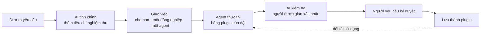

[English](README.md) · [简体中文](README.zh-CN.md) · **Tiếng Việt**

> **Tài liệu hiện có bằng tiếng Anh: [Mục lục tài liệu](docs/README.md) · [Cài đặt và khởi động](docs/getting-started.en.md) · [Hướng dẫn phát triển](docs/development.en.md)**

<div align="center">


# SoduWork

## Nền tảng AI-native cho đội nhóm và các agent của họ

**Một cuộc trò chuyện kết thúc bằng một câu trả lời. Một yêu cầu trên SoduWork chỉ kết thúc khi người đưa ra yêu cầu ký duyệt.**

<a href="https://trendshift.io/repositories/350333?utm_source=repository-badge&amp;utm_medium=badge&amp;utm_campaign=badge-repository-350333" target="_blank" rel="noopener noreferrer">
  
</a>

**Đa harness · Đa agent · Tự triển khai**

Hoạt động với Pi · OpenCode · DeepSeek Harness · Qwen Code · Kimi Code · Codex Harness · Codex

**Chạy từ mã nguồn**

```sh
git clone https://github.com/mdiri-ai/SoduWork
cd SoduWork
```

| Nền tảng | Lệnh khởi động |
| --- | --- |
| macOS / Linux | `sh start.sh --desktop` |
| Windows PowerShell | `.\start.cmd --desktop` |
| Windows Command Prompt | `start.cmd --desktop` |

Để cài đặt từ mã nguồn, chúng tôi khuyến nghị [Python 3.12.x](https://www.python.org/downloads/) và [Node.js 22.x](https://nodejs.org/) (22.19.0 trở lên trong cùng dòng). Lệnh clone dùng [Git](https://git-scm.com/downloads).

**[Ứng dụng desktop cho Windows](https://github.com/mdiri-ai/SoduWork/releases/latest)** | [Website](https://soduwork.ai) | [Demo trực tiếp](https://soduwork.ai) | [Tài liệu](docs/README.md) | [Website tài liệu](https://dev.soduwork.ai) | [Bản phát hành](https://github.com/mdiri-ai/SoduWork/releases) | [Discord](https://discord.gg/AXYNrAYHy)

[](LICENSE)
[](https://github.com/mdiri-ai/SoduWork/releases)
[](#bắt-đầu-nhanh)
[](https://discord.gg/AXYNrAYHy)

</div>

---

## SoduWork có thể làm gì cho bạn

| | |
| --- | --- |
| **Một harness làm việc, một harness khác kiểm tra** | Chọn Pi để làm việc. OpenCode, chạy trên một mô hình khác, kiểm tra kết quả theo tiêu chí nghiệm thu. Nếu không đạt, công việc được trả lại kèm lý do. |
| **Giao yêu cầu cho agent của đồng nghiệp** | Con người và AI cùng làm việc: bạn tạo một yêu cầu, AI viết tiêu chí nghiệm thu, và bạn giao cho chính mình hoặc một đồng nghiệp. Agent của người được giao sẽ thực hiện và kiểm tra công việc, rồi một người ký duyệt. Mọi người trong yêu cầu đều thấy ai đã làm gì. |
| **Biến bí quyết của một người thành tài sản của cả đội** | Khi bạn và AI làm đúng một việc, hãy lưu cuộc trò chuyện thành một plugin. Sau khi được duyệt, bất kỳ ai trong đội cũng có thể dùng và đóng góp cải tiến, với quyền truy cập được cấp theo nhu cầu. |

## Ý tưởng cốt lõi

<table>
<tr>
<td width="33%" valign="top">

**🔀 Điều phối thông minh**

**Đúng agent và đúng mô hình cho từng việc.**

- Chọn harness cho từng bước và đổi ngay giữa cuộc trò chuyện
- Các bước thường nhật chạy trên mô hình rẻ hoặc cục bộ, mô hình mạnh ở nơi thật sự quan trọng
- Việc dài chạy trên cloud runner của chính bạn

</td>
<td width="33%" valign="top">

**🛡️ Quản trị tích hợp sẵn**

**Tổ chức của bạn quyết định AI nào làm gì, và ở đâu.**

- Plugin được duyệt trước khi chia sẻ, được cấp cho đội hoặc cá nhân, và có thể thu hồi
- Vai trò, mức sử dụng, chi phí và nhật ký kiểm toán
- Tự triển khai

</td>
<td width="33%" valign="top">

**✅ Bàn giao được kiểm chứng**

**Đặt ra tiêu chuẩn trước. Hoàn thành nghĩa là người yêu cầu đã ký duyệt.**

- Mọi yêu cầu đều mang theo tiêu chí nghiệm thu của nó
- Một AI riêng biệt kiểm tra từng tiêu chí
- Con người đưa ra quyết định cuối cùng

</td>
</tr>
</table>

## Bắt đầu nhanh

> SoduWork đang ở giai đoạn beta công khai. Hãy dùng thử và cho chúng tôi biết cảm nhận của bạn, đồng thời đánh giá kỹ trước khi dùng trong môi trường production.

Clone kho mã bằng Git hoặc giải nén một bản lưu trữ mã nguồn. Xem [hướng dẫn cài đặt từ mã nguồn](docs/getting-started.en.md) để biết các điều kiện tiên quyết.

Từ thư mục gốc của kho mã, chạy `sh start.sh --desktop` trên macOS/Linux, `.\start.cmd --desktop` trong Windows PowerShell, hoặc `start.cmd --desktop` trong Command Prompt.

Nếu Windows báo một lệnh "is not recognized", hãy kiểm tra nó nêu tên lệnh nào. Với `git`, `python` hoặc `node`, kiểm tra công cụ tương ứng đã được cài và nằm trên `PATH` chưa, rồi mở lại Command Prompt. Xem [hướng dẫn cài đặt từ mã nguồn](docs/getting-started.en.md).

Lần chạy đầu tiên sẽ cài các phụ thuộc, rồi khởi động Hub, bảng điều khiển quản trị và ứng dụng desktop trên máy tính này. Đặt mật khẩu cho tài khoản `admin` (12–128 ký tự) khi được hỏi. Sau đó thêm một nhà cung cấp mô hình trong mục **Model catalog** của bảng điều khiển quản trị, bắt đầu một cuộc trò chuyện trong ứng dụng và thử một việc nhỏ. Pi được tích hợp sẵn.

### Đã thêm API key? Bắt đầu tại đây

1. **Thêm cả một mô hình chat.** Trong mục **Capabilities → Model catalog**, tìm dịch vụ bạn đã kết nối, chọn **Add model**, nhập đúng ID mô hình của nhà cung cấp, chọn **Chat model**, rồi lưu. Chỉ lưu thông tin xác thực của dịch vụ thôi thì chưa tạo được mô hình có thể chọn.
2. **Mở ứng dụng desktop và đăng nhập vào cùng một Hub.** Dùng `--desktop` khi khởi động từ mã nguồn. Bảng điều khiển quản trị trên trình duyệt cấu hình dịch vụ; kiểm tra mục **Connection** trên màn hình đăng nhập của ứng dụng desktop trỏ tới cùng Hub đó.
3. **Chọn New conversation, Pi, và mô hình bạn vừa thêm.** Pi dùng danh mục mô hình của SoduWork. Codex dùng tài khoản riêng của nó và cần đăng nhập riêng; nó không tự động dùng API key này.
4. **Thử một việc nhỏ.** Ví dụ: "Biến các ghi chú cuộc họp hư cấu này thành một bảng hành động có người phụ trách và hạn hoàn thành. Đánh dấu thông tin còn thiếu là chưa xác nhận: Alex sẽ sắp xếp các yêu cầu trước thứ Sáu; Sam sẽ kiểm tra báo giá." Kiểm tra bảng trả về đối chiếu với ghi chú.
5. **Tạo một requirement khi bạn cần giao việc và nghiệm thu.** Mô tả mục tiêu, đầu vào và tiêu chí nghiệm thu, mở **Arrange execution**, chọn một Agent và mô hình, rồi kiểm tra kết quả bàn giao trước khi chấp nhận. Một cuộc trò chuyện thông thường không cần có project, plugin hay automation trước.

Đối với tin nhắn đầu tiên, hãy dùng một **mô hình chat tương thích OpenAI với Pi**. Một lần kiểm tra kết nối thành công không đảm bảo một lần suy luận thành công: số dư, quyền của mô hình và khả năng hỗ trợ giao thức vẫn quan trọng. Nếu danh sách Agent trống, kiểm tra **Agent management** và kết nối Runner. Nếu danh sách mô hình trống, kiểm tra mô hình có tồn tại, đã được bật, và cả hai giao diện dùng cùng một Hub chưa.

Xem [Chạy từ mã nguồn: gửi tin nhắn AI đầu tiên](docs/getting-started.en.md#send-your-first-ai-message) để biết cách cài đặt từng trường và cách xử lý sự cố.

<details>
<summary><b>Thử demo trực tiếp</b></summary>

Tải ứng dụng từ [Releases](https://github.com/mdiri-ai/SoduWork/releases/latest), nhập `https://service.soduwork.ai` vào mục **Connection** trên màn hình đăng nhập, rồi đăng ký và đăng nhập.

> Demo chỉ để đánh giá. Đừng tải lên dữ liệu kinh doanh thật hay bất cứ thứ gì nhạy cảm.

</details>

<details>
<summary><b>Cài đặt ứng dụng desktop</b></summary>

Làm theo [hướng dẫn cài đặt desktop và cuộc trò chuyện đầu tiên](docs/desktop-quickstart.en.md) có hình minh họa.

| Hệ điều hành | Gói cài đặt |
| --- | --- |
| Windows | `SoduWork-<version>-Setup.exe` |
| macOS (Apple Silicon / Intel) | `SoduWork-<version>-mac-<arch>.dmg` |
| Linux | `SoduWork-<version>-linux.deb` / `.rpm` / `.tar.gz` |

Tải từ [Releases](https://github.com/mdiri-ai/SoduWork/releases). Ở lần khởi chạy đầu tiên, nhập địa chỉ Hub của bạn vào mục **Connection**, rồi đăng nhập. Trên macOS, nếu thấy "cannot verify the developer", mở **System Settings → Privacy & Security** và chọn **Open Anyway**.

</details>

<details>
<summary><b>Triển khai cho đội nhóm bằng Docker</b></summary>

Với Docker đã cài và đang chạy, từ thư mục gốc của kho mã:

```bash
python3 ops/self-host/deploy.py up
python3 ops/self-host/deploy.py credentials   # show the initial admin password
```

Cách này khởi động Hub, bảng điều khiển quản trị và PostgreSQL trên một máy chủ. Đặt một HTTPS reverse proxy phía trước để mở cho đội của bạn. Xem [Triển khai bằng Docker](https://dev.soduwork.ai/docs/get-started/docker) và [Triển khai cho đội nhóm](https://dev.soduwork.ai/docs/deploy).

</details>

Cổng, thư mục dữ liệu và xử lý sự cố nằm trong [Chạy từ mã nguồn](https://dev.soduwork.ai/docs/get-started/run-from-source) và [FAQ](https://dev.soduwork.ai/docs/get-started/faq).

## Vì sao chọn SoduWork

Agent AI cho mọi người kết quả nhanh. Điều không ai có miễn phí là niềm tin vào kết quả đó — hay một cách để giữ lại những gì đã hiệu quả. Đó là chỗ cả cá nhân lẫn đội nhóm đều mắc kẹt:

| Vấn đề | SoduWork làm gì |
| --- | --- |
| **Kết quả nhanh, niềm tin chậm** — dù bạn làm một mình hay trong đội, thời gian AI tiết kiệm được lại quay về việc kiểm tra những gì nó tạo ra | **Yêu cầu chính là bản đặc tả.** Tiêu chí được đặt ra trước khi bắt đầu việc; một AI riêng biệt kiểm tra từng tiêu chí; một người ký duyệt |
| **Thứ hiệu quả chết trong một chuỗi trò chuyện** — với một người, đó là lần chạy hoàn hảo tháng trước mà bạn không tái hiện được; với một đội, đó là phương pháp của một người mà không ai khác dùng được | **Làm đúng một lần, giữ nó thành plugin.** Tự dùng lại hoặc công bố cho mọi người — mọi cải tiến đều đến được với mọi người |
| **Một ngăn kéo đầy công cụ AI** — ba gói đăng ký và không có chuẩn nào cho việc công cụ nào làm gì | **Một bàn làm việc, một cẩm nang của bạn.** Plugin của bạn chạy trên mọi harness. Đổi ngay giữa cuộc trò chuyện, giữ nguyên lịch sử và tệp của bạn |
| **Kết quả không bao giờ đi vào quy trình làm việc** — kết quả bị sao chép dán khắp nơi, và mỗi lần bàn giao lại phải giải thích lại bối cảnh | **Issue mang theo bối cảnh.** Con người và agent tiếp nối từ chỗ nó dừng lại, với hồ sơ đầy đủ về ai đã làm gì |

## Cách hoạt động

Yêu cầu, thực thi, kiểm tra và tái sử dụng đều diễn ra trong một kho issue chung:



| Vai trò | Họ tham gia ở đâu |
| --- | --- |
| **Lập trình viên làm một mình** | Đưa yêu cầu vào kho, để agent xử lý chúng, và chỉ việc ký duyệt |
| **Chuyên gia** | Làm đúng một việc cùng AI, lưu phương pháp thành plugin, và công bố cho đội |
| **Quản lý** | Thả vào một yêu cầu; AI điền tiêu chí và định tuyến nó tới một người hoặc một agent; ký duyệt ở cuối |
| **Thành viên mới** | Dùng các plugin tổ chức đã tích lũy để làm việc theo chuẩn của đội, và cải tiến chúng khi thấy thiếu sót |

Ai đã hỏi, ai đã làm, plugin nào đã chạy và ai đã duyệt luôn được ghi lại.

## Đa harness · Đa agent

Harness là môi trường chạy agent thực hiện công việc. Nó không phải là mô hình. SoduWork kết nối mọi harness qua một giao diện adapter duy nhất, nên issue, plugin và kiểm tra không phụ thuộc vào bất kỳ harness nào. Đổi harness giữa cuộc trò chuyện và giữ nguyên lịch sử cùng thư mục làm việc. Các chương trình hỗ trợ Agent Client Protocol (ACP) có thể được thêm bằng một khai báo trong danh mục.

<details>
<summary>Các harness được hỗ trợ (7)</summary>

| Harness | Mô hình | Cách kết nối |
| --- | --- | --- |
| Pi | Các mô hình SoduWork của bạn | Tích hợp sẵn |
| OpenCode | Các mô hình SoduWork của bạn | Adapter gốc, cài theo nhu cầu |
| DeepSeek Harness | Các mô hình SoduWork của bạn, hoặc DeepSeek key của riêng bạn | ACP, cài theo nhu cầu |
| Qwen Code | Các mô hình SoduWork của bạn | ACP, cài theo nhu cầu |
| Kimi Code | Các mô hình SoduWork của bạn | ACP, cài theo nhu cầu |
| Codex Harness | Các mô hình SoduWork của bạn | ACP, cài theo nhu cầu |
| Codex | Tài khoản OpenAI của riêng nó | Adapter gốc, cài theo nhu cầu |

</details>

Agent phối hợp với nhau ở nhiều cấp độ:

| Cấp độ | Ai quyết định | Ví dụ |
| --- | --- | --- |
| Harness | Chính harness | OpenCode hoặc Qwen Code tự khởi động các subagent của nó để khám phá mã hoặc chia nhỏ một việc |
| Phương pháp đơn | Một Skill hoặc plugin đặt ra phương pháp, quy trình, quy tắc và điều gì được tính là xong | Một plugin kiểm tra bảo agent chạy những kiểm tra nào và đính kèm bằng chứng gì |
| Phương pháp kết hợp | Một workflow của plugin chọn harness, Skill và mô hình cho từng bước | Pi soạn thảo, Qwen Code kiểm tra nguồn, và lần chạy dừng lại nếu kiểm tra không đạt |
| Con người và agent | Người yêu cầu và người được giao hoặc agent của họ | Một yêu cầu đến tay một đồng nghiệp, agent của họ làm việc, người yêu cầu ký duyệt |
| Song song | Hub | Các issue khác nhau chạy trên các agent khác nhau cùng lúc, kể cả trên cloud runner |

Giữa các bước và giữa mọi người, công việc di chuyển theo cách plugin và người được giao quy định. Agent không tự ý bàn giao công việc cho agent khác.

## Plugin và ứng dụng

Một skill cho AI biết cách làm một việc gì đó. Một agent gói AI thành một trợ lý. Plugin và ứng dụng của SoduWork biến cách đội của bạn làm việc thành thứ **chạy được, được kiểm chứng, cải tiến được và luôn được quản trị**.

| | Skill | Agent | Plugin SoduWork | Ứng dụng SoduWork |
| --- | :---: | :---: | :---: | :---: |
| **Nó là gì** | Một tài liệu phương pháp mà AI đọc và làm theo | Prompt, kiến thức, công cụ hoặc một luồng của nền tảng | Một gói có phiên bản: phương pháp, đầu vào, tiêu chí nghiệm thu, workflow | Một plugin có UI riêng<br/>và một panel trò chuyện AI |
| **Phù hợp nhất cho** | Một kỹ thuật đơn lẻ | Một loại công việc | Công việc chuẩn của đội, do AI chạy | Công việc lặp lại trong một UI chuyên dụng |
| **Cách dùng** | AI tự tiếp nhận | Bên trong nền tảng của nó | `/` trong trò chuyện · trên issue · trong automation | Cửa sổ riêng của nó + thanh bên AI |
| **Quy trình từng bước** | ✗ | ◐ | ✓ | ✓ |
| **Chọn và đổi harness** | ✗ | ◐ | ✓ | ✓ |
| **Tiêu chí, AI kiểm tra, ký duyệt** | ✗ | ◐ | ✓ | ✓ |
| **Phiên bản hoá** | ✗ | ◐ | ✓ | ✓ |
| **UI và tương tác** | ✗ | ◐ Trò chuyện | ◐ Trò chuyện | ✓ |
| **Duyệt, cấp, thu hồi** | ◐ Có thể cấu hình | ◐ Có thể cấu hình | ✓ | ✓ |

<sub>✓ Được hỗ trợ　◐ Một phần　✗ Không được hỗ trợ. "Agent" nghĩa là một trợ lý được xây trên một nền tảng agent điển hình; khả năng khác nhau tuỳ nền tảng.</sub>

**Từ cuộc trò chuyện của bạn tới cẩm nang của bạn — của riêng bạn hoặc của đội**: tạo hoặc lưu một plugin trong trò chuyện → kiểm tra trước và thử cục bộ → giữ cho riêng mình, hoặc gửi duyệt và công bố lên danh mục của đội. Dùng một mình thì nhẹ nhàng; chia sẻ cho đội thì thêm duyệt, cấp quyền và phiên bản hoá.

<details>
<summary>Ví dụ: một bản tin tuần được kiểm tra đối chiếu với nguồn của nó</summary>

```json
{
  "schemaVersion": 1,
  "key": "weekly-brief",
  "version": "1.0.0",
  "name": "Weekly brief",
  "workflow": {
    "nodes": [
      { "key": "draft", "type": "ai", "config": { "agentKind": "local:pi", "prompt": "Write deliverables/brief.md from this week's tasks." } },
      { "key": "check", "type": "ai_review", "dependsOn": ["draft"],
        "config": { "agentKind": "local:qwen", "prompt": "Check each claim against the sources. Block if any claim has no source." } },
      { "key": "done", "type": "publish", "dependsOn": ["check"] }
    ]
  }
}
```

</details>

Bạn không phải tự viết thứ này bằng tay: mô tả công việc cho Plugin Developer trong một cuộc trò chuyện và nó sẽ tạo ra tệp. Xem [hướng dẫn plugin](https://dev.soduwork.ai/docs/plugins) và [ứng dụng](https://dev.soduwork.ai/docs/apps).

## SoduWork so sánh ra sao

- **So với các công cụ dựng agent low-code**: không canvas, không nối node. Hoàn thành một việc thật và lưu nó thành plugin. Agent làm việc trực tiếp trên tệp và dự án thật, cục bộ hoặc trên cloud.
- **So với các harness agent lập trình**: SoduWork không thay thế chúng. Nó chạy chúng như các harness bên trong một không gian làm việc của đội và bổ sung những gì chúng không có: issue chảy từ yêu cầu tới thực thi tới ký duyệt, AI kiểm tra độc lập, duyệt và phân phối plugin, và kiểm soát truy cập kèm kiểm toán.
- **So với các hệ điều phối đa agent**: con người đặt ra các bước và điểm kiểm soát, và người yêu cầu chấp nhận kết quả bàn giao dựa trên bằng chứng. Công việc di chuyển giữa các bước và con người theo cách plugin và người được giao quy định.
- **So với trợ lý văn phòng AI**: bí quyết không nằm lại trong lịch sử trò chuyện của một người. Nó trở thành một plugin đã được duyệt, có phiên bản — được chính bạn ngày mai tái sử dụng, và cả đội tháng sau.

<details>
<summary>Bảng so sánh</summary>

| | Công cụ dựng agent low-code | Harness agent lập trình | Hệ điều phối đa agent | Trợ lý văn phòng AI | SoduWork |
| --- | :---: | :---: | :---: | :---: | :---: |
| Chuyên gia nghiệp vụ xây dựng và tinh chỉnh agent ngay trong trò chuyện | ◐ | — | — | ◐ | ✓ |
| Công việc kỹ thuật và phi kỹ thuật | ✓ | ◐ | ◐ | ✓ | ✓ |
| Trộn harness và mô hình theo nhu cầu | ◐ | — | ✓ | — | ✓ |
| Tiêu chí nghiệm thu tích hợp trong yêu cầu, ký duyệt trên bằng chứng | — | — | ◐ | — | ✓ |
| Duyệt plugin, công bố và truy cập theo phạm vi | ◐ | — | — | ◐ | ✓ |
| Sản xuất cấp doanh nghiệp và cộng tác đội nhóm | ◐ | ✓ | ◐ | ✓ | ✓ |
| Dùng ngay mà không cần xây tầng nghiệp vụ | — | ✓ | — | ✓ | ✓ |
| Dịch vụ lưu trữ sẵn | ✓ | ◐ | ◐ | ✓ | ◐ Tự triển khai |

## Kiến trúc

**Những phần khó, đã được xử lý:**

| Phần khó | SoduWork xử lý ra sao |
| --- | --- |
| Các client bất đồng về sự kiện | Hub là nguồn sự thật duy nhất: issue, workflow, phê duyệt và bằng chứng đều nằm trong Hub, nên mọi client đều thấy cùng một sự kiện |
| Agent có quyền truy cập mà chúng không nên có | Quyền truy cập được cấp, không được mặc định: chính sách của tổ chức, tính sẵn sàng lúc chạy và lựa chọn của người dùng cùng nhau quyết định một phiên được dùng những gì. Cài đặt một thứ không có nghĩa là được phép dùng nó |
| Khóa chặt vào một harness | Một giao diện adapter cho mọi harness: các tầng cao hơn không bao giờ phụ thuộc vào một harness cụ thể. Đổi harness giữa cuộc trò chuyện và giữ nguyên lịch sử cùng thư mục làm việc |
| Phương pháp không di chuyển được | Phương pháp và môi trường tách biệt: plugin định nghĩa phương pháp; harness, mô hình, runner và bí mật được chọn khi plugin được gắn kết. Phiên bản plugin là bất biến và di chuyển được |
| Công việc không ai truy vết được | Tương tác và thực thi tách biệt: client xử lý trò chuyện và phê duyệt; runtime và runner làm việc — cục bộ hoặc từ xa — và mọi lần chạy đều vào hồ sơ kiểm toán |

<p align="center"></p>

<details>
<summary>Bên trong runner</summary>

<p align="center"></p>

Runner kết nối tới Hub qua WebSocket. Mỗi lần điều phối đều có một ID, nên cùng một việc không bao giờ bị nhận hai lần. Mỗi harness chạy trong tiến trình con riêng của nó. Sự kiện được lưu trên máy thực thi trước khi gửi đi, và được gửi lại sau khi mất kết nối.

</details>

<details>
<summary>Giới hạn đã biết</summary>

- **Bàn giao lên cloud di chuyển bối cảnh, không di chuyển tiến trình**: tệp làm việc, cuộc trò chuyện và mục tiêu di chuyển lên cloud runner. Tiến trình đang chạy và phiên trình duyệt thì không, và bạn tự mang máy chủ của mình.
- **Một plugin không phải lúc nào cũng là workflow**: một plugin có thể chỉ cung cấp một phương pháp hoặc một công cụ. Workflow dành cho công việc nhiều bước, các điểm phê duyệt và tiếp tục sau khi thất bại.
- **Runner và skill không phải sandbox đa năng**: mức cách ly thực tế phụ thuộc vào harness và môi trường của bạn. Chỉ kết nối runner tới một Hub mà bạn tin cậy.

</details>

## Dữ liệu của tôi đi đâu?

- Khi bạn tự triển khai, issue, plugin và lịch sử trò chuyện được lưu trong Hub của chính bạn, và các tác vụ chạy trong thư mục bạn chọn.
- Yêu cầu gửi tới mô hình đi từ runner tới nhà cung cấp mô hình bạn cấu hình. Mỗi lần chạy nhận một thông tin xác thực ngắn hạn; key không bị ghi dạng văn bản thuần vào tệp cấu hình của harness.
- Prompt và tệp gửi tới một nhà cung cấp mô hình hoặc một connector bạn cấu hình sẽ hiển thị với dịch vụ đó. Với mô hình tự triển khai, suy luận có thể ở lại trong môi trường của bạn.

**Telemetry và cập nhật.** Mã nguồn công khai này không bao gồm một cơ chế tải lên phân tích hay báo cáo lỗi riêng tới MDiRi. Client mặc định trỏ tới `https://service.soduwork.ai`; các yêu cầu vận hành của nó đi tới Hub được chọn trong mục **Connection** trên màn hình đăng nhập. Bạn có thể thay đổi địa chỉ này, và lựa chọn đã lưu của bạn được giữ qua các lần khởi động lại và nâng cấp. Dùng dịch vụ lưu trữ sẵn nghĩa là gửi các yêu cầu đó tới nhà vận hành của nó. Chọn Hub của riêng bạn giữ lưu lượng này trong triển khai của bạn.

- Hub được chọn nhận xác thực thiết bị/tài khoản và dữ liệu mà các tính năng bạn dùng yêu cầu. Kế toán sử dụng bao gồm ID và tiêu đề cuộc trò chuyện, định danh Agent/mô hình/nhà cung cấp, bộ đếm token và chi phí, và dấu thời gian. Các lần thử cập nhật báo cáo phiên bản, tiến độ, trạng thái và lỗi. Đây là hồ sơ vận hành, không phải một gói đăng ký phân tích tuỳ chọn.
- Client đã cài kiểm tra Hub được chọn để tìm bản cập nhật khi khởi động và định kỳ (mỗi sáu giờ). Các lần kiểm tra bao gồm phiên bản hiện tại, nền tảng, kiến trúc CPU và kênh cập nhật, được xác thực bằng phiên thiết bị. Client chạy từ mã nguồn bỏ qua kiểm tra cập nhật của bộ cài. Hiện chưa có cài đặt riêng để tắt kế toán của Hub hay việc thăm dò cập nhật của client đã cài; dùng Hub của riêng bạn để tránh gửi lưu lượng này tới dịch vụ lưu trữ sẵn. Yêu cầu ghi chú phát hành cũng dùng Hub được chọn.
- Thống kê hiệu năng yêu cầu/cơ sở dữ liệu của Hub được duy trì bên trong tiến trình Hub; chúng không được tự động xuất tới MDiRi. Phụ thuộc và các bản tải Agent tuỳ chọn liên hệ tới registry gói hoặc mirror đã cấu hình của chúng, và mô hình/connector liên hệ tới các dịch vụ bạn cấu hình. Các dịch vụ đó có chính sách dữ liệu riêng.

## Câu hỏi thường gặp

<details>
<summary><b>Tôi làm việc một mình. SoduWork có quá mức cần thiết với tôi không?</b></summary>

Không, nếu bất kỳ điều nào sau đây đúng: bạn tự kiểm tra lại kết quả của AI, bạn không tái hiện được quy trình hoàn hảo của tháng trước, hoặc bạn chỉ muốn các công cụ AI của mình dùng chung một chuẩn. Dùng một mình không cần cài đặt đội nhóm — chạy cục bộ với SQLite bằng một lệnh, và các tính năng tổ chức đơn giản là nằm yên cho tới khi bạn cần. Cùng plugin, cùng bàn làm việc, thêm người khi bạn muốn.

</details>

<details>
<summary><b>Đây có phải chỉ là một nền tảng agent hay hệ điều phối nữa không?</b></summary>

SoduWork không thay thế các harness agent — nó chạy chúng bên trong một không gian làm việc của đội và bổ sung tầng mà chúng không có: một kho issue chung từ yêu cầu tới ký duyệt, tiêu chí nghiệm thu tích hợp trong mọi issue, một bước AI kiểm tra độc lập, duyệt plugin với cấp quyền theo phạm vi, và dấu vết kiểm toán. Con người đặt ra các bước, điểm kiểm soát và phê duyệt.

</details>

<details>
<summary><b>Dự án này có đang được bảo trì tích cực, hay chỉ là một bản demo?</b></summary>

Đây là một bản beta công khai đang hoạt động. Mọi bản phát hành đều có ghi chú phát hành, và quy trình phát hành chạy các kiểm tra của kho mã cùng bộ kiểm thử trước khi một phiên bản được công bố. Xem [Lộ trình](#lộ-trình) để biết điều gì sắp tới, và [Đóng góp](#đóng-góp) nếu bạn muốn tham gia.

</details>

<details>
<summary><b>Tại sao tôi cần đăng nhập, và dữ liệu của tôi ở đâu?</b></summary>

Tài khoản là nền tảng của tổ chức, quyền hạn, cộng tác và kiểm toán. Khi bạn tự triển khai, bạn đăng nhập vào Hub của chính mình và dữ liệu của bạn được lưu ở đó. Xem [Dữ liệu của tôi đi đâu?](#dữ-liệu-của-tôi-đi-đâu)

</details>

Thêm câu trả lời trong [FAQ trên trang của nhà phát triển](https://dev.soduwork.ai/docs/get-started/faq).

## Lộ trình

| Trạng thái | Hạng mục |
| --- | --- |
| ✅ Đã phát hành | Hỗ trợ cloud runner (Personal Agent) |
| Đang thực hiện | Bộ công cụ phát triển cho plugin và ứng dụng |
| Đang thực hiện | Quản lý sandbox cho cloud runner |
| Đang thực hiện | Ứng dụng web và di động |
| Đã lên kế hoạch | Hỗ trợ marketplace cho ứng dụng và plugin trong triển khai doanh nghiệp và riêng tư |

Ý tưởng được hoan nghênh tại [Discussions](https://github.com/mdiri-ai/SoduWork/discussions).

## Cộng đồng

- **Trò chuyện**: [Discord](https://discord.gg/AXYNrAYHy)
- **Lỗi và yêu cầu tính năng**: [GitHub Issues](https://github.com/mdiri-ai/SoduWork/issues)
- **Câu hỏi và ý tưởng**: [GitHub Discussions](https://github.com/mdiri-ai/SoduWork/discussions)
- **Doanh nghiệp**: triển khai riêng, tích hợp và hỗ trợ. Email [contact@soduwork.ai](mailto:contact@soduwork.ai).

## Đóng góp

Issue, ý tưởng, plugin, tài liệu và mã đều được hoan nghênh.

1. Đọc [hướng dẫn đóng góp](CONTRIBUTING.md) để biết cách cài đặt cục bộ và các kiểm tra cần chạy trước một pull request.
2. Fork, tạo một branch và commit các thay đổi của bạn.
3. Mở một pull request kèm mô tả thay đổi và cách bạn đã kiểm thử nó.

<details>
<summary>Hướng dẫn cho nhà phát triển</summary>

| Mục tiêu | Đọc |
| --- | --- |
| Xây một plugin | [Hướng dẫn plugin](https://dev.soduwork.ai/docs/plugins) |
| Xây một ứng dụng | [Ứng dụng](https://dev.soduwork.ai/docs/apps) |
| Thêm một harness | [Thêm một harness ACP](https://dev.soduwork.ai/docs/harnesses/add-acp-harness) |
| Triển khai và vận hành | [Triển khai cho đội nhóm](https://dev.soduwork.ai/docs/deploy) |
| Lệnh và cấu hình | [Tài liệu tham khảo](https://dev.soduwork.ai/docs/reference/commands) |

</details>

### Người đóng góp

<a href="https://github.com/mdiri-ai/SoduWork/graphs/contributors">
  
</a>

## Bảo mật

Xin đừng báo cáo vấn đề bảo mật trong các issue công khai. Làm theo [SECURITY.md](SECURITY.md) để báo cáo riêng.

## Giấy phép và ghi công

Mã của chính SoduWork thuộc bản quyền MDiRi và được phát hành theo [Giấy phép MIT](LICENSE). Mã, phông chữ, đồ họa và công cụ đóng gói của bên thứ ba giữ giấy phép riêng của chúng; xem [Thông báo bên thứ ba](https://dev.soduwork.ai/docs/reference/third-party). Tên và logo SoduWork là thương hiệu của MDiRi và không được cấp phép theo MIT.

Cảm ơn Electron, React, FastAPI, SQLAlchemy và hệ sinh thái mã nguồn mở rộng lớn hơn, cùng các dự án agent mà SoduWork vận hành. Việc được liệt kê ở đây không có nghĩa là một dự án ủng hộ SoduWork.
